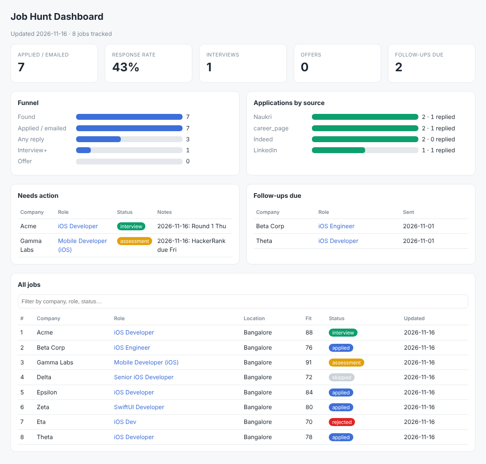

# 🎯 job-hunter

**A Claude plugin with 18 skills that job hunts for you — honestly.**
Finds jobs within hours of posting · writes a tailored, ATS-tested resume for every job · applies and emails HR after one daily approval · tracks every reply.

[**🚀 Get started**](docs/GETTING-STARTED.md) · [**🧰 All skills**](docs/SKILLS.md) · [**▶️ Watch the demo (1:17, with narration)**](docs/job-hunter-demo.mp4) · [**🌐 Website**](https://mohammedsharukhh.github.io/job-hunter/) · [**❓ FAQ**](docs/FAQ.md)

---

## Start in 3 steps

1. **Install** — download [`job-hunter.plugin`](https://github.com/mohammedsharukhh/job-hunter/releases/latest) and open it in the Claude app
   *(Claude Code: `/plugin marketplace add mohammedsharukhh/job-hunter` then `/plugin install job-hunter@job-hunter-marketplace`)*
2. **Set up** — in a new chat, attach your resume and say **"set up job hunter"**
3. **Relax** — it now runs by itself every day. You just approve one list.

> **Just want one tailored resume?** Install, attach your resume and say:
> *"tailor my resume to this job: \<paste the job description\>"*

👉 Full walkthrough with screenshots-in-words: **[Getting started guide](docs/GETTING-STARTED.md)**

---

## What it does for you

| | |
|---|---|
| ⏱️ **Be first** | Checks your dream companies' job boards **every hour** and alerts you to new roles within hours |
| 🔎 **Find** | Searches LinkedIn, Naukri, Bayt, GulfTalent, Indeed and career pages — skips duplicates, old listings and scams |
| ✍️ **Tailor** | Rewrites your resume for **each** job description — only true facts, gaps reported honestly |
| ✅ **Prove** | Tests every resume like hiring software would (**ATS self-test**) and **fact-checks** it against your profile |
| 📮 **Apply** | Fills in portals and emails official HR contacts — **one by one, after your approval** |
| 📬 **Follow up** | Reads replies, drafts answers, adds interviews to your calendar, one polite follow-up |
| 🎤 **Get hired** | Mock interviews with scores, referral messages, salary check & negotiation |
| 📊 **Improve** | Dashboard + weekly insights on what gets replies |

---

## Talk to it like a person

| Say | You get |
|---|---|
| *set up job hunter* | One-time setup from your resume |
| *tailor my resume to this job: …* | Tailored resume, match score, gaps |
| *check my resume for ATS* | Score out of 100 + what to fix |
| *watch Zoho and Careem for iOS jobs* | Hourly alerts for new roles |
| *check my job emails* | Replies sorted, answers drafted |
| *prep me for my Acme interview* | Research + mock interview |
| *I got an offer — is it fair?* | Market check + negotiation email |
| *show my dashboard* | Your numbers at a glance |
| *pause job hunter* | Stops all automatic runs |

See **[all 18 skills explained simply](docs/SKILLS.md)**.

---

## Safe by design

- 🚫 **Never invents** experience, skills, numbers or certificates
- ✋ **Your approval first** — nothing is submitted or sent without it
- 📮 **No spam** — official contacts only, daily limit, max one follow-up
- 🔐 **Your data stays on your computer** — never types passwords, flags job scams

---

## Community results

Real, anonymous, opt-in numbers from users (say *"share my job-hunter stats"* to add yours):

<!-- RESULTS:START -->
_No submissions yet — be the first: see “Share your results” below._

_Role: not enough submissions yet (need ≥3 per group)._

_Region: not enough submissions yet (need ≥3 per group)._

_Source: not enough data yet._

_Resume template: not enough data yet._

Self-reported, anonymous, opt-in. Groups with fewer than 3 people are hidden. Not a guarantee of results.
<!-- RESULTS:END -->

---

## For developers & contributors

- **How it's built:** [docs/HOW-IT-WORKS.md](docs/HOW-IT-WORKS.md)
- **Quality checks:** `python3 -m unittest discover -s tests` and `python3 evals/run_golden.py` ([evals/README.md](evals/README.md))
- **Contribute:** region packs, job-board guides, resume layouts, interview question banks for other roles — see [CONTRIBUTING.md](CONTRIBUTING.md)
- **Release:** push a tag like `v0.3.1` → GitHub builds `job-hunter.plugin` automatically
- **Website:** Settings → Pages → branch `main`, folder `/docs`

⭐ **If job-hunter helps you, star the repo so others can find it.**

MIT © Mohammed Sharuk M S
