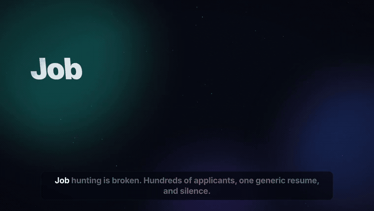

# job-hunter 🎯 — an open-source job-search copilot for Claude

A Claude plugin (Claude Code and the Claude desktop app) that turns your job hunt into **one daily approval**. It finds jobs, tailors your resume to every job description, applies on career portals, emails HR one by one, chases referrals, preps interviews, and learns what actually gets replies.



▶️ [Watch the 2-minute demo](docs/job-hunter-demo.mp4) · 🌐 [Website](https://<owner>.github.io/job-hunter/) · 📊 [Community results](docs/RESULTS.md)

**No setup? Try it in one message:** install the plugin, attach your resume and say *“tailor my resume to this job: &lt;paste JD&gt;”*.

## What's inside — 18 skills

**Core loop**
| Skill | What it does |
|---|---|
| `job-hunt` | Runs everything: replies → find → tailor → referrals → prepare → **one approval** → submit/send one by one → dashboard |
| `quick-tailor` | **Zero setup**: paste a resume + JD → tailored ATS resume, match score, honest gaps, cover letter |
| `job-watchlist` | **Hourly** check of target companies' Greenhouse / Lever / Ashby / Workable / SmartRecruiters boards — apply within hours of posting |
| `job-hunt-setup` | Builds your master profile from your resume, preferences, region pack and tracker |
| `find-jobs` | Searches job-board connectors, LinkedIn/Naukri/Bayt etc. in your browser, and company career portals. Filters **duplicates, ghost jobs and scams**; fit score learns from jobs you reject |
| `tailor-resume` | Resume tailored to each JD (3 layouts) + cover letter, then two gates: **ATS self-test** (PDF read back like an ATS) and **fact check** (nothing not in your profile) |
| `apply-to-job` | Fills portal applications with the tailored resume; you approve before submit |
| `hr-outreach` | Finds the official HR/careers contact and sends personalised emails **one at a time** after you approve the day's list; daily cap, one follow-up |
| `check-updates` | Reads your inbox for confirmations, tests, interviews, rejections, offers; updates tracker, drafts replies |

**Get hired**
| Skill | What it does |
|---|---|
| `interview-prep` | Company brief, likely questions (HR, technical, DSA, resume deep-dive), STAR answers, **live mock interview with scores** |
| `skill-gap-coach` | Finds skills you keep missing across target JDs → learning plan + portfolio projects |
| `referral-finder` | Finds 1st/2nd-degree connections and alumni at target companies, drafts referral asks |
| `offer-negotiation` | Market salary check for role + city, offer comparison, negotiation email & call script |
| `linkedin-profile` | Recruiter-optimised headline, About, skills and Open-to-work settings |

**Learn & track**
| Skill | What it does |
|---|---|
| `job-insights` | Reply rates by source, resume layout, email template and fit band → recommends changes (A/B testing) |
| `job-dashboard` | Visual dashboard: funnel, response rate, needs-action, follow-ups due |
| `daily-brief` | Short morning summary; can schedule itself every weekday |
| `share-stats` | Opt-in, anonymous results (counts and rates only) for the public results page |

**Region packs:** India · Gulf · EU/UK · US (job boards, resume conventions, salary sources).
**Example profiles:** iOS developer · procurement · mechanical engineer · data analyst.

## Install

**Claude Code**
```bash
/plugin marketplace add <your-github-username>/job-hunter
/plugin install job-hunter@job-hunter-marketplace
```
**Claude desktop app** — download `job-hunter.plugin` from [Releases](../../releases) and open it.

Then say **"set up job hunter"** and attach your resume. **That's the last command you need** — from then on it runs by itself:
- **Every time you open Claude**, it checks your job hunt and starts today's run automatically if it hasn't happened yet (or just reminds you of interviews and deadlines).
- **Even when Claude is closed**, scheduled tasks run the daily job hunt, check your watchlist every hour, and send a morning brief.
- You only step in to approve the day's list (or switch `outreach.mode`). Say **"pause job hunter"** any time to stop it.

### Connect (recommended)
- **Email** (Gmail/Outlook connector) — sending, drafts, reply tracking
- **Browser** (Claude in Chrome) — career portals, LinkedIn, Naukri… with your own sign-ins
- **Calendar** — interviews
- **Job board** connector (e.g. Indeed) — structured search

Scripts need Python 3.9+ and `pip install python-docx`; LibreOffice for PDF export (optional).

## Examples
```
run my job hunt — iOS roles in Bangalore and Doha, top 5
tailor my resume for this JD: <paste>
prep me for my Acme interview on Thursday — mock interview please
what's working in my applications?
I got an offer from Beta Corp — is it fair?
send me a job brief every weekday at 8:30am
```

## Quality you can check
- `scripts/ats_check.py` — ATS self-test for **any** resume: `python3 scripts/ats_check.py My_Resume.pdf`
- `scripts/fact_check.py` — flags numbers, skills, employers or credentials not in your profile
- `evals/` — reference cases; CI fails if an honest resume stops passing or a fabricated one stops being caught (see `evals/README.md`)

## Your data stays yours
Everything lives in a local `job-hunt/` folder (profile, tracker, applications). It's git-ignored — never commit it.

## Guardrails (please keep them in forks)
- **No fabrication** — resumes only reword/reorder facts in your profile; gaps are reported, not invented.
- **Your approval first** — approve the day's list once (or each item); then items go out **one by one** with a gap between sends and a daily cap.
- **Official contacts only** — no guessed/scraped personal emails; honours "not interested"; max one follow-up.
- **No credentials** — never types passwords/OTPs, solves captchas, or handles ID/bank details.
- **Respect site terms** — human-paced browsing, stops at bot checks. You're responsible for using it within each site's terms.
- **Scam flags** — fees to apply, ID/bank requests before an offer, unrealistic pay.

## Community results
Anonymous, opt-in numbers from real users (updated automatically from the “📊 Share my results” issue form):

<!-- RESULTS:START -->
_No submissions yet — be the first: ask Claude “share my job-hunter stats”._
<!-- RESULTS:END -->

## Website
Enable GitHub Pages (Settings → Pages → branch `main`, folder `/docs`). The site fills in your repo links automatically.

## Releasing
Push a tag like `v0.2.0`. The GitHub Action validates the plugin, smoke-tests the scripts and attaches `job-hunter.plugin` to the release.

## Contributing
PRs welcome — new region packs, job-board guides, resume layouts, question banks for other roles. See `CONTRIBUTING.md`.

## License
MIT
